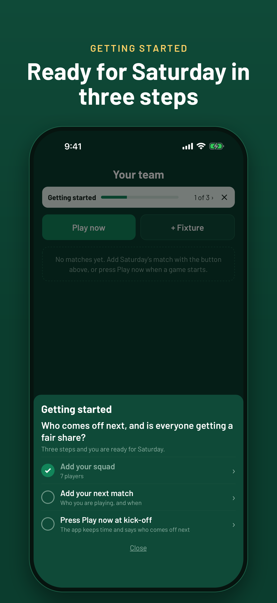
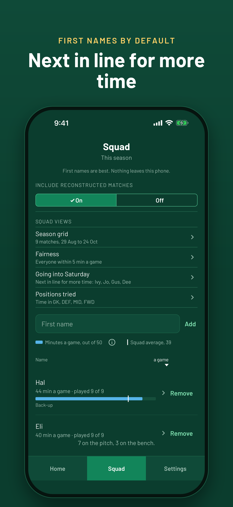
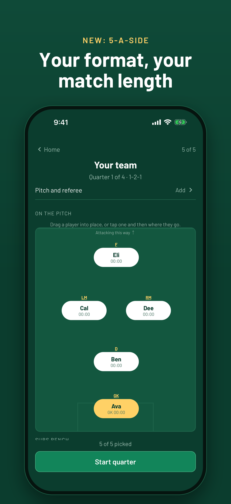
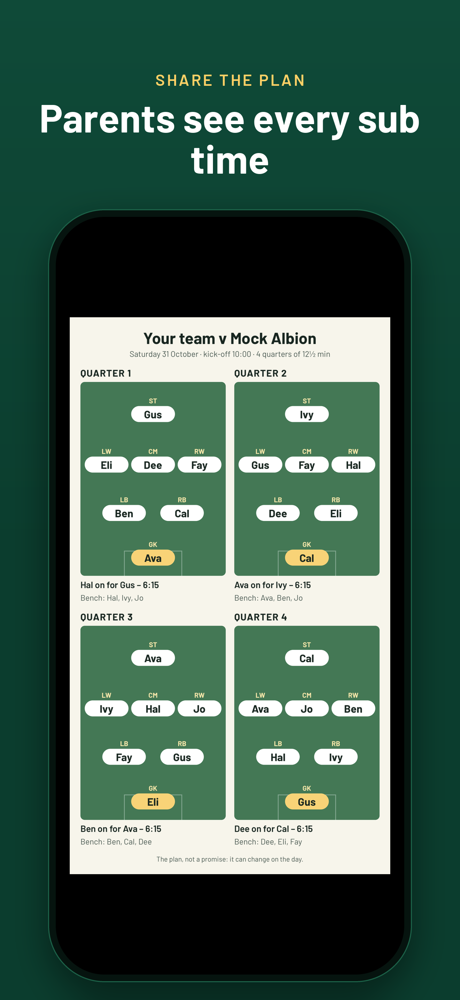
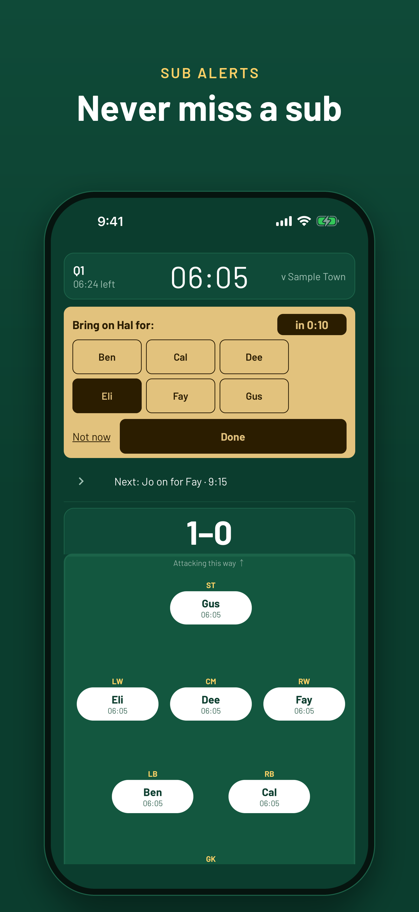
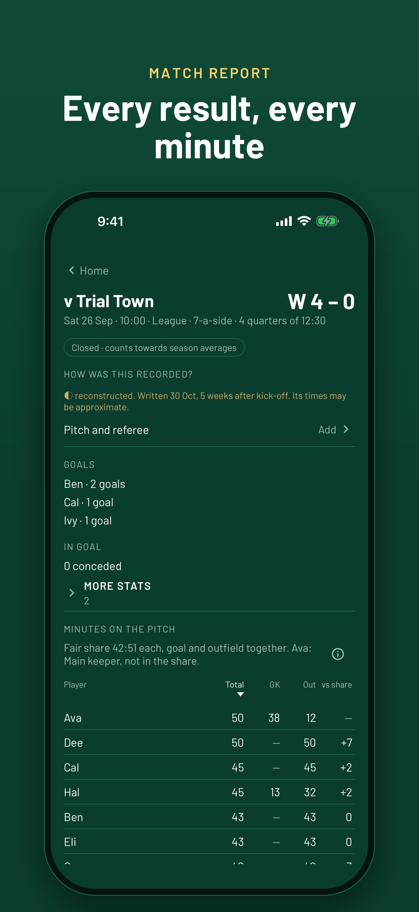
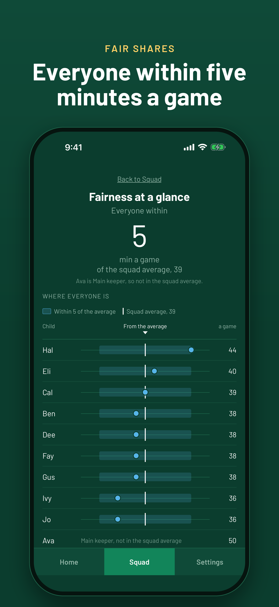
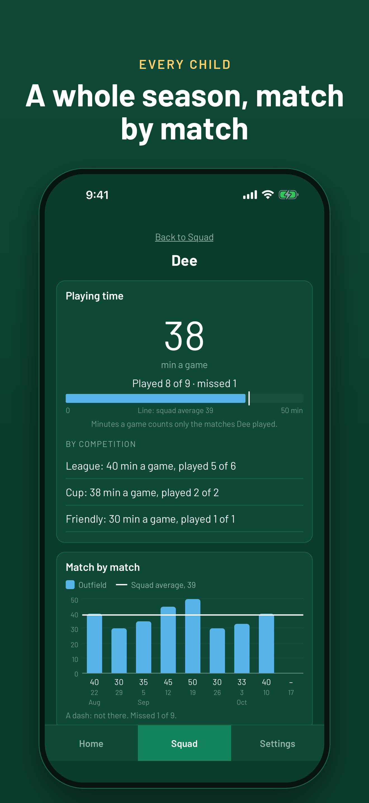

# How to use Heart FC Coach

A guide for a coach using the app for the first time. It follows a normal
week: set up your team on Tuesday, plan on Friday, run the match on Saturday,
then see who is getting a fair share.

The app answers one question at the touchline: **who comes off next, and is
everyone getting a fair share?** It suggests; you always decide.

Don't have the app yet? See [Try Heart FC Coach](https://vanstoner.github.io/coaching-app/coaches.html) for how to
install it on an iPhone or an Android phone.

**In this guide**

1. [Set up your team](#1-set-up-your-team)
2. [Add your squad](#2-add-your-squad)
3. [Add a fixture](#3-add-a-fixture)
4. [Plan the match](#4-plan-the-match)
5. [On the day: the lineup](#5-on-the-day-the-lineup)
6. [During the match](#6-during-the-match)
7. [After the final whistle](#7-after-the-final-whistle)
8. [Is everyone getting a fair share?](#8-is-everyone-getting-a-fair-share)
9. [Keep your season safe](#9-keep-your-season-safe)
10. [More than one team, and a new season](#10-more-than-one-team-and-a-new-season)
11. [Fixing mistakes](#11-fixing-mistakes)
12. [Practise without touching your figures](#12-practise-without-touching-your-figures)

The pictures in this guide use a made-up squad. No real child is in them.

---

## 1. Set up your team

The first time you open the app it says **No teams on this phone yet**.

- Tap **Add your team**. Give the team a name, the season ("2026–27"), the
  age group, the level and the **main format**: 5-, 7-, 9- or 11-a-side, with
  a shape such as 2-3-1 or 4-4-2. The age group suggests a size (U7–U8
  5-a-side, U9–U10 7-a-side, U11–U12 9-a-side, U13 and up 11-a-side), and you
  can change it.
- The match length follows the size: 5- and 7-a-side start at 50 minutes in
  quarters, 9-a-side at 60 minutes in halves, 11-a-side at 70 minutes in
  halves. You can change these in **Settings › Match defaults**.
- Just want a look first? Tap **Try it with a made-up team**, in Getting started on
  Home or on the empty Squad tab. It loads a made-up squad, two fixtures and a past season,
  so every screen has something in it. When you add your first real player,
  the app offers to clear the made-up team.

Home then shows a **Getting started** line with three steps: add your squad,
add your next match, and press Play now at kick-off. Each step ticks itself
off, and the line goes away when all three are done.

## 2. Add your squad

Open the **Squad** tab, type a child's first name and tap **Add**.

- **First names are best.** For two children with the same name, add an
  initial ("Alex S"). The app never asks for a surname, a birthday or a photo,
  and it warns you before saving a name with more than one word.
- Tap a child to open **their page**. Under **Preferences** you can say
  whether they like to go in goal, where they prefer to play, and their
  outfield share target. These help the suggestions; they are never used to
  judge fairness.
- A child from another team helping out for the season? On their page, under
  **Fairness**, mark them as a **fill-in**. They still get a fair share on the
  day, but their minutes don't move your squad's average.
- A child who leaves: **Remove** them. If they have played, they are kept in
  past matches and their minutes stay true.

## 3. Add a fixture

On **Home**, tap **+ Fixture**.

- Fill in the **Opposition**, the day and **Kick-off time**, and the
  **Competition** (League, Cup, Friendly or Tournament).
- **Minutes**, **Periods** and **Shape** start from your defaults. Change
  them for this match only if you need to. If you pick a shape of another
  size (say a 9-a-side match in a 7-a-side season), the app says so: the
  match is kept, but left out of the season's fairness figures unless you
  choose to count it.
- **Pitch, referee and stats** is optional: the surface, how good the pitch
  was, and the referee's name. The referee's name only ever shows on your
  own phone's match screens.
- Tap **Save fixture**. It appears under **Coming up** on Home.

No time to plan? On match day just tap **Play now**. It starts a match from
your defaults, with no form to fill in.

## 4. Plan the match

On a fixture under **Coming up**, tap **Plan this match** (or **Edit the
plan** once you've started one).

- For each quarter or half, put the children on the pitch and on the bench.
  Each child's **projected minutes** for the match show as you go, so you can
  see before kick-off whether anyone is short.
- Tap **Add a sub** to plan a substitution. It starts at the middle of the
  period. Change its time, and who comes off, in the sheet. Leave who comes
  off as **Whoever is on longest** and the app picks on the day.
- **Same as quarter 1** (or half 1) copies the period before, to save typing.
- **Share plan** makes one picture of the plan for parents: positions, every
  sub and its time, and the bench. It shows no minutes and doesn't say who is
  unavailable. Choose **2 × 2, best on a phone** or **Four in a row**, then
  send it from your phone's share sheet.

A plan is only a plan: it never moves a minute. What counts is what actually
happens on the day.

## 5. On the day: the lineup

Open the match from Home (or tap **Play now**). You arrive on the lineup for
the first period.

- **Here today**: untick anyone who isn't there. They can't be picked, and the
  app knows they missed the match. Someone turns up late? Between periods,
  **Arrived late?** adds them.
- **Use plan** fills the pitch from your plan. **Use suggestion** fills it
  from the app's suggestion: the children who have had least time on the
  pitch go on first, and the goalkeeping is shared round. Both can be undone.
- **Goalkeeper**: pick who starts in goal.
- Drag a child onto a position to move them, or tap one child and then
  another to swap them.
- Tap a child on the **Bench** to plan when they come on, and for whom.
- When the referee blows, tap **Start quarter** (or **Start half**).

## 6. During the match

The clock shows the period, the time left and the score. It keeps true time
even if the phone locks or you close the app, because it works from when the
period started rather than counting seconds.

- **Who's next.** The line above the pitch says who comes on next, and when:
  "Next: Ava on for Ben · 6:15". Tap it to see every sub planned for this
  period.
- **Sub alerts.** 30 seconds before a planned sub, a prompt rises. It's green,
  turns amber in the last 15 seconds, then red if you're late, and the phone
  buzzes once (while the app is open). Make the change on the pitch, then tap
  **Done**. **Not now** puts the prompt away for this period.
- **Change of plan?** Tap a sub in the list to move it 30 seconds, change who
  comes off, or remove it. Drag players on the pitch to swap positions or to
  bring someone on. **Plan the rest of the match** re-plans what's left.
- **Goals and more.** Tap a player on the pitch for picture buttons: Goal,
  Shot, Tackle, Corner, Free kick, and Save or Conceded for the keeper. After
  a goal the app asks **Who set it up?** for the assist. Slipped? Tap **Undo**
  within 10 seconds.
- **Awards.** Tap a player and **Give *name* an award**, for example Player
  of the Week. You can also give them at full time.
- **End of a period.** Tap **End quarter** (or **End half**). If you forgot
  and it ran over, the app asks whether it ended at the planned time or just
  now, so nobody is credited with minutes they didn't play. You go back to
  the lineup for the next period.
- **Leave** takes you to Home and the match keeps running. Open it again from
  **Now** on Home.

## 7. After the final whistle

After the last period, tap **See the minutes** for the match report: the
result, and every child's time on the pitch, in goal and outfield, against
the match's fair share.

- **Tap End match.** This is the step that matters most. Only a match closed
  with **End match** counts towards the season's figures.
- If an award hasn't been given yet, the app asks first. **Give them later**
  is fine.
- **Correct attendance** fixes who was there, with a note.
- A one-off game that shouldn't count, such as a friendly with mixed teams?
  **Leave this match out**, with a note. Its minutes are kept, but it's left
  out of the averages. You can count it again later.

## 8. Is everyone getting a fair share?

**Fairness is total time on the pitch, in goal and outfield together.**
Positions are a record of where a child has played, never a target.

The **Squad** tab has four views:

- **Season grid**: every child's minutes, match by match.
- **Fairness**: how close the squad is to an even share, such as "Everyone
  within 5 min a game".
- **Going into Saturday**: who is next in line for more time, the children 5
  minutes or more under the squad average this season.
- **Positions tried**: time in goal, defence, midfield and attack.

Tap a child's row in **Fairness** or **Going into Saturday** to open **Why
the difference**: the sum behind their figure and every match it comes from.
Each child's own page shows their playing time, match by match.

Wondering how a figure is worked out? Tap the **ⓘ** beside it, or see
**Settings › Player minutes › About the figures**.

## 9. Keep your season safe

Everything stays on your phone. There's no account and nothing is sent to us.

- The app is included in your phone's own backup (iCloud or Google), so a
  lost or replaced phone can get its season back.
- **Settings › Backup › Back up this app** puts every team into one file.
  Save it somewhere private, or email it to yourself. The Backup heading says
  when you last made one.
- On a new phone: **Restore from a backup** (in Settings › Backup, or on the
  first screen of a fresh install). It shows what the file holds before
  anything changes.

## 10. More than one team, and a new season

- **Another team.** Tap the team name at the top of Home (or **Settings ›
  Switch team**), then **+ Add a team**. Each team has its own squad,
  fixtures and figures, and you switch between them like profiles.
- **A new season.** From 1 August, once a season is ten months old, Home
  offers to start the next one. Or go to
  **Settings › Season › Start a new season**. The squad carries over, the age
  group moves up a year (and the format with it, so a U10 7-a-side team
  becomes U11 9-a-side), and every season figure starts at zero. Nothing is
  deleted: past seasons stay readable in Settings › Season.

## 11. Fixing mistakes

Nothing that happened in a match is ever rewritten. A mistake is fixed with a
correction and a short note, so the record always shows what happened and
what was changed.

- A goal or event entered wrongly: **Withdraw** it in the match's time
  stream, with a note.
- A match recorded by mistake: on its report, **Void, with a note**. It
  disappears from every figure.
- Attendance wrong: **Correct attendance** on the report.
- A goal you forgot to enter: open the match **In the record** and add it,
  with a note.

## 12. Practise without touching your figures

**Settings › Test matches › Start a test match** runs a match with today's
squad on the real screens, at normal speed or 5 or 10 times faster. It never
counts towards anything, and you can delete it afterwards. It's a good way to
get used to the clock before your first Saturday.

---

**Starting again.** **Settings › Danger zone › Forget everything** removes
every team, match and minute from the phone. Back up first if you might want
them again.

**Questions or ideas?** See [Support](https://vanstoner.github.io/coaching-app/support.html), or tell Rob on WhatsApp.
How the app looks after your data is in the [privacy policy](https://vanstoner.github.io/coaching-app/privacy.html).
