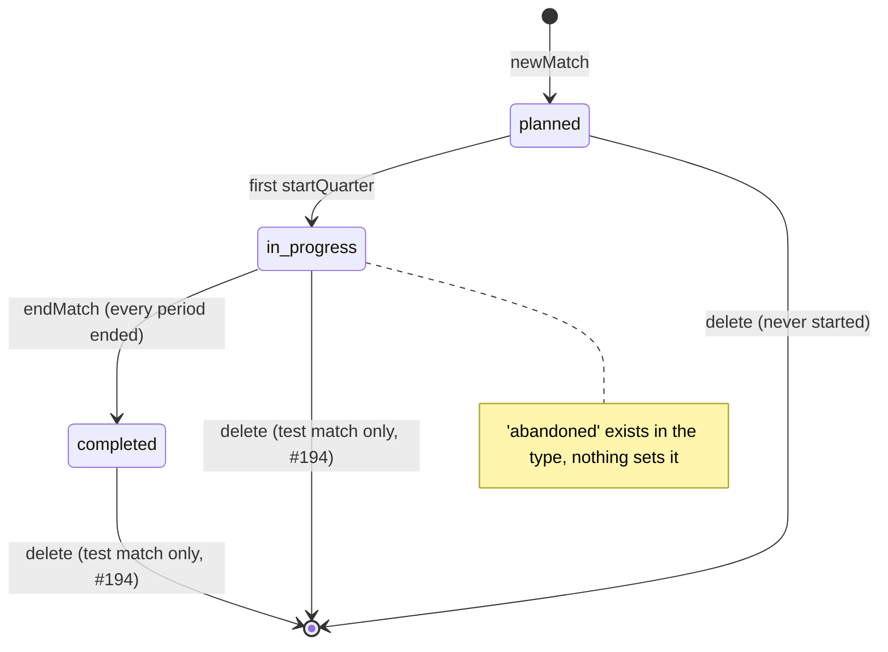

# Domain models

Status: **Current** (checked against the code of 2.2.0 at `961c856`, 31 Oct 2026, the release check; 2.1.0 at `b5174a8`; before that `64d145f`, #259). First retrofitted from `src/types/index.ts`, `src/engine/MatchEngine.ts`, `src/app/persistence.ts` and `src/app/ledger.ts` at `e04fbb0`, 2026-10-09.
Last updated: 2026-10-31 (2.2.0 release check: 9- and 11-a-side in Match, the record's `season` and `structure`, #249; 2.1.0 release check: a fill-in in a match's fair share, #261; 2.1.0 check, #259; 2.0.0 truth pass, #248; earlier #239, #173, #180, #184, #188, #192, #193, #202, #195, #190)

The types are the source of truth; this page names the rules the types cannot
express. Spec 01 ([01-domain-model.md](./archive/v1-specs/01-domain-model.md), archived
by #239) was the approved v1 foundation; this is the shape actually shipped.

## Identity

```ts
type UUID = string & { readonly __brand: 'UUID' };  // uuid(): Hermes-safe, no crypto.randomUUID dependency
```

## Squad and players

```ts
interface Player {
  id: UUID; squadId: UUID;
  firstName: string;              // validateName: trimmed; the first word of a confirmed name (#54, invariant 4)
  displaySuffix: string | null;   // the rest of a confirmed name ("S", "Van Stone"); whole name ≤16 chars (#54)
  squadNumber: number | null;
  active: boolean;                // false = retired; kept forever, never deleted once played
  createdAt: string;
  keeper?: 'main' | 'backup' | 'never' | null;
  prefers?: 'DEF' | 'MID' | 'ATT' | null;
  outfieldTargetPct?: number | null;  // shown beside figures, never a fairness input (ADR-015)
}
```

- No surname, DOB, contact or photo field may be added (invariant 4).
- First names by default (#54): a name of more than one word is saved only
  after the coach confirms a warning, split at the first space into
  `firstName` and `displaySuffix` (`splitName`). A rename keeps the id and
  writes a new `player` record; latest wins.
- A player who has played is retired, not deleted (`playedPlayerIds`).
- `PlayerPositionAffinity` (`primary | secondary` per position) is read by
  `suggestLineup`, but no screen passes any: the keeper preference
  (`keeper`, #86) does that job. `Squad` and `Availability` are declared and
  unused; availability is stored per match (below).

## Format and positions

```ts
interface Format   { id: UUID; name: string; onFieldCount: number; positions: Position[] }
interface Position { id: UUID; formatId: UUID; label: string; kind: 'goalkeeper' | 'outfield';
                     unit: 'GK' | 'DEF' | 'MID' | 'ATT' | null; roleCode?: string; sortOrder: number }
```

- Exactly one `goalkeeper` position per format.
- Eight built-in shapes (`src/app/shapes.ts`), each a list of slots with a
  renameable label and a fixed unit: **2-3-1 + GK** and **2-2-2 + GK**
  (`name` "7-a-side", `onFieldCount` 7); **1-2-1 + GK** (GK, D, LM, RM, F) and
  **2-2 + GK** (GK, LB, RB, LF, RF), "5-a-side", `onFieldCount` 5 (#223);
  **3-3-2 + GK** and **3-2-3 + GK**, "9-a-side"; **4-4-2 + GK** and
  **4-3-3 + GK** (wingers measured as ATT), "11-a-side" (#249, ADR-023). A
  code is permanent and unique across sizes; no two shapes of one size share
  unit counts (ADR-023 D2). A shape code a build does not know is refused on
  import, never swapped for another size (D4).
  `shapeOfFormat` reads a shape from its unit counts, never its labels. Every
  count of players (lineup, readiness, Getting started, plan, pitch, plan
  image) is the match format's `onFieldCount`, never a fixed 7.
- A match **snapshots** its format (ADR-012). Changing the squad default never
  reshapes a saved fixture. Renaming positions changes labels only (#166).

## Match

```ts
type MatchStatus = 'planned' | 'in_progress' | 'completed' | 'abandoned';
interface Match {
  id: UUID; squadId: UUID; formatId: UUID;
  opponent: string | null; competition: 'league' | 'cup' | 'friendly' | 'tournament' | null;
  kickoffAt: string | null;
  totalMinutes: number;       // default 50; offered 40, 50, 60, 70, 75, 80, 90 (40: #223; 70, 80: #249)
  quarterCount: number;       // periods: 4 (quarters) or 2 (halves)
  status: MatchStatus; createdAt: string;
  excludeFromStats?: boolean;               // #187: "Leave out" on the form; the record's `exclusion` takes over (ADR-020)
  test?: { clock: { offsetMs: number; speed: 1 | 5 | 10; sinceMs: number } }; // #194
  seasonId?: UUID;                          // 2.0.0, #243 AC11: the season it was made in; absent = first season
  surface?: '3g' | '4g' | 'grass';          // 2.1.0, #254: on the fixture record too
  condition?: 'excellent' | 'good' | 'poor';
  referee?: string;                         // 2.1.0, #254 Q2: this phone and the coach's backup only, NEVER the record
}
```

A **test match** (`test` set, #194, ADR-021 D3) is started from Settings, kept
in the session only and never passed to `recordMatches` (`recordable`, with a
second check inside `recordMatches`). Its engine reads its own clock
(`matchClock`): the app's time at ×1, ×5 or ×10, so its speed reaches nothing
else. It is on no screen but Settings › Test matches, and deletes outright.



| From | To | Trigger | Guard |
|---|---|---|---|
| `planned` | `in_progress` | `engine.startQuarter` (first period) | lineup valid, enough players |
| `in_progress` | `completed` | `endMatch` → `engine.completeMatch` (ruling D) | every period `ended` |
| any | `abandoned` | **nothing sets it** | read in `fixtures.ts`, `matchClosing.ts` only |

Only a match with no started period may be deleted (`canDeleteFixture`), or
a test match, which was never in the record (`deleteTestMatches`). A played
real match is left out (ADR-020) or voided (`match-kind: void`), never deleted.

## Period (`Quarter`)

```ts
type QuarterStatus = 'pending' | 'running' | 'ended';
interface Quarter {
  id: UUID; matchId: UUID; index: number;   // 1-based
  status: QuarterStatus;
  startedAt: string | null; endedAt: string | null;
  runningSinceWallClock: string | null;     // anchor; non-null iff running
  accumulatedMs: number;                    // frozen at end; 0 while running
  elapsedMs: number;                        // derived mirror; the engine never reads it
}
```



```mermaid
stateDiagram-v2
    [*] --> pending
    pending --> running: startQuarter (sheet valid; previous ended)
    running --> ended: endQuarter (accumulatedMs frozen; stretches closed)
    note right of running: past planned + 1 min, End offers planned time (floored at the last event) or now (#180)
```

- `pending → running → ended`, one way, in index order; at most one `running`.
- `endQuarter(state, q, atQuarterElapsedMs?)`: an end earlier than now is
  allowed only past planned + 60 s, never before the last thing recorded
  (`lastRecordedInQuarter`). `endedAt` keeps the tap time; it is not a
  correction (#180, Spec 02 Q6).
- Elapsed = `accumulatedMs + (now − runningSinceWallClock)` (invariant 2).
  Never incremented by a timer.

## Time on the pitch

```ts
interface Appearance {                      // a player in a position, one stretch
  id: UUID; matchId: UUID; quarterId: UUID; playerId: UUID; positionId: UUID;
  positionKind: 'goalkeeper' | 'outfield';  // snapshotted
  positionUnit: PositionUnit | null;
  startElapsedMs: number; endElapsedMs: number | null;  // match-elapsed; null while open
  endReason: 'substitution' | 'position_change' | 'quarter_end' | 'match_end' | 'correction' | null;
  corrected: boolean; correctionNote: string | null;
}
interface BenchStint { id; matchId; quarterId; playerId; startElapsedMs: number; endElapsedMs: number | null }
```

- In a running period every available player has exactly one open Appearance
  **or** one open BenchStint (`validatePlayerTrackingInvariant`).
- Player minutes are **folded**, never stored: `foldPlayerMinutes` sums closed
  and open stretches, clamped at 0. Fairness = outfield + goalkeeper (ADR-015).

## Events and corrections

```ts
interface MatchEvent {
  id: UUID; matchId: UUID; quarterId: UUID;
  kind: 'goal' | 'shot_on_target' | 'save' | 'conceded'
      | 'tackle' | 'corner' | 'free_kick'      // in-play tallies (#185)
      | 'assist' | 'withdrawn'
      | `tally:${string}`;                     // a coach's own kind (#198)
  playerId: UUID | null;    // for 'conceded', the keeper in goal at the time
  atElapsedMs: number; recordedAt: string;
  refersTo: UUID | null;    // 'withdrawn': the event taken back; 'assist': its goal
  note: string | null;      // required (non-blank) iff kind = 'withdrawn'
}
```

- `goal`, `shot_on_target`, `tackle`, `corner`, `free_kick`: anyone on the
  pitch. `save` / `conceded`: the goalkeeper only. `assist`: asked after a
  goal, from the others on the pitch.
- **Derived, never stored:** the score (goals and conceded); shots on target
  = tapped shots **plus goals** (#202); their shots on target = our saves plus
  goals against.
- A withdrawal cannot be withdrawn; an event is withdrawn at most once.
- Attendance after kick-off changes only by a noted correction in the ledger
  (ruling F). Nothing is ever deleted (invariant 5).

## Availability

`'available' | 'absent' | 'injured' | 'unavailable'`, per match, keyed by
player. Editable freely before kick-off; afterwards only via a late arrival or
a noted correction. The ledger snapshots it at kick-off (ADR-014 §4).

## Plans (intent, never minutes)

```ts
interface MatchPlan     { periods: PlannedPeriod[] }
interface PlannedPeriod { slots: Record<UUID /*positionId*/, UUID | null /*playerId*/>; subs: PlannedSwap[] }
interface PlannedSwap   { onId: UUID | null; offId: UUID | null; atMs: number }
interface PlannedSub    { playerId: UUID; atMs: number; forPlayerId: UUID | null; done: boolean }  // live reminders
```

A plan only pre-fills the lineup. The running period's subs are saved as
`periodSubs` so a relaunch restores reminders (#139).

## Persisted documents

Since 2.0.0 every document below is one team's: it is stored under
`coaching-app/teams/<teamId>/…` (ADR-022 D2), and the root holds only the team
index `coaching-app/teams/v1`. A team's name is its squad's name, read from
its session, never copied into the index.

```ts
interface TeamIndex {                       // key coaching-app/teams/v1, at the root (#224)
  version: 1; current: UUID | null;         // null: "No teams on this phone yet" (AC6)
  teams: { id: UUID; createdAt: string; removedAt: string | null }[];   // removed: set aside, keys kept (AC9)
  migration?: { state: 'copying' | 'copied' | 'done'; teamId: UUID };   // the one-time move (D3)
}
interface SavedSession {                    // key coaching-app/session/v1 (per team), schemaVersion 6
  schemaVersion: number; minReaderVersion: number; savedAt: string;
  squadName: string; squadId: UUID; players: Player[];
  format: Format; totalMinutes: number; periodCount: number; buzzWhenSubDue: boolean;
  plan: Record<string, UUID[]>;             // the old squad-level plan; this build writes {} (plans are per match, #72)
  matches: SavedMatch[]; currentMatchId: UUID | null;
  // + any unknown fields from a newer build, preserved on write
}
interface SavedMatch {
  match: Match; quarters: Quarter[]; appearances: Appearance[]; benchStints: BenchStint[];
  availability: [UUID, AvailabilityStatus][];
  format?: Format; plan?: MatchPlan; archived?: boolean; events?: MatchEvent[]; periodSubs?: PeriodSubs;
}
```

```ts
interface Ledger {                          // key coaching-app/ledger/v2
  ledger: 'coaching-app/minutes'; ledgerVersion: number; minReaderVersion: number; writtenAt: string;
  entries: LedgerEntry[];                   // the only stored part: hash-chained (ADR-014)
  // folded from entries, never stored:
  squad: { id: UUID; name: string }; players: LedgerPlayer[]; matches: LedgerMatch[];
  fixtures: LedgerFixture[]; profiles: LedgerProfile[]; settings: LedgerSettings | null;   // #195
  awardTypes: LedgerAwardType[]; eventTypes: LedgerEventType[];                              // #197, #198
  seasons: LedgerSeason[];                  // #243, ADR-022 D5; none: one implicit first season
  viewSeason?: UUID;                        // set only on a season's view (ledgerForSeason), never stored
}
// entry: { seq, prev, at, kind, records, hash, device?, sig? }
// record types: squad | player | match | interval | event | attendance
//             | exclusion (ADR-020) | device (#193) | match-kind (#194)
//             | fixture | profile | settings (#195, ADR-021 D2)
//             | season | format-count (2.0.0: #243, ADR-022 D5; Rob's ruling 8A)
//             | origin (ADR-021 D2: read if a file carries one, never written by this build)
// player   { id, firstName, displaySuffix, active }   // #54: displaySuffix null for a one-word name
// fixture  { id, kickoffAt, opponent, competition, totalMinutes, periodCount, shape, labels[],
//            excludeFromStats, state: 'planned' | 'cancelled', archived, note,
//            season?,                     // 2.0.0: the season it was made in, kept by every save; absent = first season
//            surface?: '3g' | '4g' | 'grass', condition?: 'excellent' | 'good' | 'poor' }   // 2.1.0, #254: absent when unset
// season   { id, name, startedAt, mainSide: 5 | 7 | 9 | 11 | null, ageGroup: 'U7'…'U18' | null,
//            level: 'development' | 'competitive' | null, lens: 'full', note }   // the coach's inputs only;
//            first season's id is 'first-season'; current = latest started after it (#243 AC1, AC9)
// format-count { matchId, counted, note }   // #243 AC8: an off-format match counted in, or left out again
// profile  { playerId, keeperPreference, prefers, outfieldTarget, active, removed,
//            fairness: 'counted' | 'not-counted', note }   // fairness changes only with a note (#190)
// settings { squad, shape, labels[], totalMinutes, periodCount, buzzWhenSubDue }
// structure { matchId, periodCount, periodMs[], shape, onField, note }   // #196: as the clock ran, or a noted correction; shape '2-3-1' | '2-2-2' | '1-2-1' | '2-2' (#223) | '3-3-2' | '3-2-3' | '4-4-2' | '4-3-3' (#249), onField 5, 7, 9 or 11
// award-type { id, name, active, note }                        // #197; defaults 'player-of-the-week', 'mr-assister'
// award      { matchId, awardTypeId, playerId, given, note }   // key includes the child: joint winners
// event-type { id, label, tier: 'tally', credited: 'child' | 'team', active, note }   // #198; events of it: kind 'tally:<id>'
// interval  + role?: 'RB' | 'LW' | …       // #196 AC4; absent on older intervals, which read per unit
// event     + timeKnown?: false           // #196 AC2; then period 0, atMs 0 (the released build needs a number)
```

- **Left out of the figures** (ADR-020): an `exclusion` record, latest wins,
  with a note after kick-off. Views use `isCounted`; the file summary does not.
- **A season's side** (ADR-015 §6a, #223; #243 AC2): derived on every read,
  never stored. `seasonSide` takes the season's `mainSide` once the coach has
  set it; until then the dominating format, the on-field count
  (`structure.onField`) with the most counted matches, latest known on a tie; `inFairness` leaves a match in
  another format out of every average, the season difference (under or over the average) and the trend, and keeps its
  minutes in totals. A match with no recorded format never votes and is never
  left out. A `format-count` record with `counted: true` (#243 AC8) brings an
  off-format match back in; latest wins, always with a note.
- **Seasons** (#243, ADR-022 D5, D6; `src/app/seasons.ts`): a match belongs to
  the season named on its fixture, else the first season (`first-season`),
  never by date. The current season is the latest started after the first; a
  season ends when the next starts. Every season figure folds from
  `ledgerForSeason`, which keeps only that season's matches and fixtures.
  A season is a `LedgerSeason`. **The code differs from ADR-022 D5 here
  (#261 D4):** the ADR says `PlayerSeasonTotals` is deleted from
  `src/types/index.ts` and `Season` redrawn without `squadId` and `endDate`;
  both are still there as before, and nothing imports either. No figure is
  stored per season either way. Removing them is the Engineer's (#261).
- **Signed** (#193, ADR-021 D4): each install has an Ed25519 key in the
  platform's secure store and publishes its public key once in a `device`
  record. Its entries carry `device` and `sig` (over the entry without `hash`
  and `sig`); `hash` covers `sig`, so older builds still verify. Checking:
  `signatureStatuses` (`unsigned | valid | invalid | unknown-device`); a bad
  signature never refuses a chain.
- **Hidden** (#194, ADR-021 D3): a `match-kind` record, latest wins, always
  with a note: `test` (the one-off clean-up) or `void` ("Void, with a note"
  on a played match's report) hides the match from every screen
  (`visibleLedger`); `real` shows it again. The chain keeps it either way.
- **Fixtures, profiles and settings** (#195, ADR-021 D2): written by every
  save when they change, latest wins. A save never decides a fairness mark,
  a cancellation or a note; those are explicit acts with a note. A deleted
  unplayed fixture is a `cancelled` record. A test match (#194) is never a
  fixture in the record. Clearing the made-up team cancels its fixtures to
  come and marks its children `removed`, so a restore never brings them back.
  The released build carries all three untouched (tested against a frozen
  1.2.0 reader).
- **Not counted in fairness** (#190): `profile.fairness = 'not-counted'`,
  for the whole season. Out of the squad average, fairness figures and the
  season difference; never out of the record, a match's totals or a match's
  fair share on the day, the report's and the Plan's alike (`matchFairShare`,
  #261 ruling 1b, which also leaves Main keepers and absent children out).
- **The core match record** (#196): the **result** is folded from goal and
  conceded events, never stored. A goal or goal against with **time unknown**
  counts in the score and in no per-period or per-time figure; a goal with
  no scorer counts in no child's figure. **Structure** is written by the save
  that closes a period (the periods that ended, as long as each ran), never
  over a noted correction and never for a match first seen already played,
  which reads as planned. An interval keeps the role it was recorded with,
  or none: it is never rewritten to add one.
- **Awards** (#197): individual performance (ADR-017), shown for one match;
  never a fairness or minutes input. A change is new records, never an edit.
- **Tiers** (#198): `goal`, `assist`, `conceded` are core and feed the
  result. Everything else, and any kind this build does not know, is a
  coach's tally: shown apart, never in the score, minutes or fairness.
- **Provenance** (#199, ADR-021 D4): `pristine | live-unsigned |
  reconstructed`, derived in `provenance.ts` from entry signatures, entry
  times against the match window, corrected intervals, records added after
  the last period and any `origin` record. Never stored.
- **Proposed, not built yet:** writing `origin` (ADR-021 D2): setting it by
  hand waits until it is asked for (#199 ruling); one carried from a file is
  read.

- Ledger: append-only, each entry hashes its predecessor; recording is
  idempotent by id; an import extends the chain or is refused, never merged.
- Ledger, unreadable or failing verification: set aside under its own key,
  never overwritten. Too new for this build: shown, never written.
- Session: older versions are migrated (`MIGRATIONS`). One that will not read
  is copied aside under `session/v1/unreadable/<time>` and read back before a
  new one is written; one too new for this build is never written (#173).
  `validate()` checks players, positions, periods and stretches element by
  element: a bad squad is set aside, a bad match is left out after the whole
  document is copied aside (#184). Saves run one at a time per store.
- **App backup** (#192; #224 AC7, ADR-022 D4): `coaching-app/phone-backup`
  version 2 since 2.0.0, `{ teams: [{ id, removed, session, ledger }] }`, every
  team in one file; 1.x refuses it as newer. A restore is per team: the same
  id is replaced after its data is copied to
  `coaching-app/before-restore/<time>/…` and read back, a new id is added, a
  team not in the file is left alone. A version 1 file restores into the open
  team.
- **Forget everything removes every key the app owns, every team's and the
  team index included, copies kept aside included**, except the test clock's offset (#207, `src/app/storage/forget.ts`). The
  removal runs behind any save in flight; its result is not shown, so a key it
  could not remove stays without a message.
