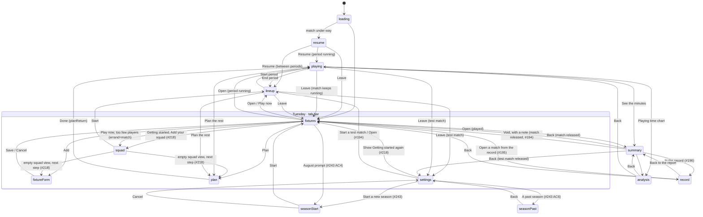

# System architecture

Status: **Current** (checked against the code of 2.1.0 at `64d145f`, 29 Oct 2026, #259). First retrofitted from the code at `e04fbb0` (v1.0.1), 2026-10-09.
Last updated: 2026-10-30 (the control vocabulary `src/screens/controls/`, #264; Settings sections and two phone keys, #263; 2.1.0 check, #259; 2.0.0 truth pass, #248; earlier #239)

One page. Where it and the code disagree, the code wins. Fix this page.

## Stack

| | Version | Note |
|---|---|---|
| Expo (managed, `expo prebuild` in CI) | 57.0.23 | No `android/` or `ios/` checked in |
| React Native | 0.86.3 | New Architecture, Hermes, edge-to-edge mandatory on Android |
| React | 19.2.3 | |
| TypeScript | 5.9 | `strict: true`; no `any` in `src/` outside tests |
| Storage | `@react-native-async-storage/async-storage` 3.1.1 | Behind `KeyValueStore` |
| Safe areas | `react-native-safe-area-context` ~5.7.0 | The shell pads once; bottom sheets add the bottom inset (#174) |
| Signing (#193) | `@noble/ed25519` 3.2, `@noble/hashes` 2.4 (pure TS); `expo-secure-store`, `expo-crypto` ~57.0.4 | Key made from `expo-crypto` bytes, kept in the Keystore/Keychain; the biometric permissions the store brings are blocked in `app.json` |
| Other native modules | `expo-file-system`, `expo-sharing`, `expo-font`, `react-native-view-shot`, `expo-status-bar`, `@expo/vector-icons` | Minutes file and app backup export/import, Share plan image, the Barlow font, icons on the event buttons and Getting started |

No navigation library, no state library, no network client. The one React Context is `TableSortProvider` (`src/screens/TableSort.tsx`), which remembers each table's sort: a view choice, not app state (ADR-019). See [ADR-001](./decisions/001-react-native-expo.md), [ADR-018](./decisions/018-session-and-ledger-in-asyncstorage.md) and [ADR-019](./decisions/019-shell-owns-state-step-machine-routes.md).

## Layout

```
index.ts            registerRootComponent(App)
App.tsx             the shell (`App`: teams) and `TeamApp` (one team's state, every action, the router); about 3,100 lines
src/engine/         MatchEngine — pure TS, mutates a MatchState in place
src/types/          domain types, uuid() (Hermes-safe)
src/app/            pure rules, each with a *.test.ts beside it
src/app/storage/    the storage modules: teams, session, ledger store, backup, forget, device key
src/screens/        React components; take props, hold only view state
src/screens/controls/  the one control vocabulary every screen draws from (#264): Row ›, Section
                    heading (the twisty), Segmented, list sheets, Stepper, Action, Main button,
                    Field row, ✓ Saved / Not saved yet, Back, Cancel/Save sheets, Danger
.github/            CI, APK/IPA builds, releases, store listing
```

Screens take their controls from `src/screens/controls/` (#264); the pure
rules behind them are in `src/app/saveState.ts` (✓ Saved, a form's state, a
sheet that writes only on Save), `src/app/plannedSubSheet.ts` (the planned-sub
stepper and its words) and `src/app/settingsSections.ts` (#263).
`src/screens/controlsGuard.test.ts` names each screen still allowed its own
controls, and why.

Rule: `src/engine` and `src/app` import no React and no platform module, with
four exceptions in `src/app`: `storage/storage.ts` (AsyncStorage), `ledgerFile.ts`,
`planImageFile.ts` (file system, sharing) and `storage/deviceKey.ts` (secure
store, random bytes).

## State lifecycle

```mermaid
sequenceDiagram
    participant Sh as App (shell, 2.0.0)
    participant A as TeamApp
    participant S as AsyncStorage
    participant E as MatchEngine
    Sh->>S: openTeams: index coaching-app/teams/v1; first launch of 2.0.0 moves the phone's keys into team 1 (copy, prove, commit, set aside, ADR-022 D3)
    Sh->>A: mount the open team (key = team id) with teamStore(root, id); none → "No teams on this phone yet" (#224 AC6)
    A->>A: installDeviceSigner (key from the secure store, #193)
    A->>S: getItem getting-started/v1 (card closed on this phone? #218)
    A->>S: openStoredSession (session/v1; unreadable → set aside, #173)
    A->>S: openStoredLedger (ledger/v2 + head)
    A->>A: recordMatches(recordable(back-fill): test matches never, #194; + fixtures, profiles, settings #195) → commitLedger
    A->>S: saveLedger (queued)
    A->>A: step = resume | fixtures
    Note over A: every state change
    A->>E: engine.substitute / startQuarter / endQuarter (mutates state)
    A->>S: saveSession (whole document, queued)
    A->>S: saveLedger (only if records changed; a test match is in the session only, #194)
```

- **All durable state lives in `App.tsx`** `useState`s: the shell (`App`) holds
  the team list and its sheets; `TeamApp` holds one team's state and is
  remounted on a switch, so no team's state reaches another. Screens receive
  values and callbacks. Screens take the raw `Ledger`: ADR-017's gate
  (`ledgerGate.ts`, `LedgerView`) is not built.
- **The live match** is `{ engine, state, format }`. The engine mutates
  `state` in place; the shell then calls `persist()` (and `repaint()` where no
  other state changes).
- **Time** is never counted. `getQuarterElapsedMs` = `accumulatedMs + now −
  runningSinceWallClock`. `ClockScreen` reschedules a `setTimeout` to the next
  displayed second, and `MatchAnalysisScreen` runs a 1 s `setInterval`, both
  only to repaint. `appNow()` (`src/app/appClock.ts`) is the
  single clock. A beta phone's stored offset is kept, but the Test kit no
  longer speeds it (#228); a test match keeps its own ×1/×5/×10 (#194).
- **Saves are fire-and-forget.** A failed write keeps the match running in
  memory. The session's and the ledger's writes both run one at a time per
  store (`inTurn`, in `src/app/storage/sessionStore.ts` and `src/app/storage/ledgerStore.ts`).

## Storage

**Teams (2.0.0, ADR-022 D2).** Every per-team key below is stored under its
team's prefix: `coaching-app/session/v1` in team T is
`coaching-app/teams/T/session/v1`. `teamStore` (`src/app/storage/teams.ts`)
rewrites the keys, so each module keeps its constants; work queues on the
device store beneath it. Per install, at the root: the team index
`coaching-app/teams/v1` (`{ version, current, teams: [{ id, createdAt,
removedAt }], migration? }`), `before-teams/…` (the keys as they were before
2.0.0, set aside by the move), the test clock, the signing key, and two view
notes about the phone (#263): which Settings sections are open and when this
phone last made a backup. A team's store passes these phone keys through to
the root, and the move into teams leaves them alone (`PHONE_KEYS`).

| Key (per team unless marked) | Contents | Writer | Versioning |
|---|---|---|---|
| `coaching-app/session/v1` | `SavedSession`: squad, defaults, every match (planned, live, played), plans | `saveSession` | `schemaVersion` 6, `MIGRATIONS` in `persistence.ts`, unknown fields kept |
| `coaching-app/ledger/v2` | Minutes ledger: hash-chained entries (ADR-013, ADR-014); since #195 also fixtures, profiles and settings, so a phone can be restored from it | `saveLedger` (serialised queue) | own format version; too-new → read-only |
| `coaching-app/ledger/head` | Last chain head, guards rollback | `saveLedger` | |
| `coaching-app/ledger/v1` | Pre-v2 ledger, read for upgrade only | none | |
| `coaching-app/ledger/v2/unreadable/<iso>` | A ledger that failed to verify, set aside intact | `openStoredLedger` | |
| `coaching-app/session/v1/unreadable/<iso>` | A session that would not read, set aside intact (#173, #184) | `openStoredSession` | |
| `coaching-app/before-restore/<iso>/…` | What was on the phone before a restore (#192) | `restorePhoneBackup` | Removed by Forget everything (#207) |
| `coaching-app/table-sort/v1` | Each analytics table's chosen sort, a view choice on this phone (#208) | `TableSortProvider` | Never in the record; removed by Forget everything |
| `coaching-app/settings-sections/v1` (root) | `{"open":[…]}`: which Settings sections are open, a view choice on this phone (#263 AC5); Danger zone is never stored | `SettingsScreen` | Never in the record; removed by Forget everything |
| `coaching-app/last-backup/v1` (root) | When Back up this app last made its file and handed it on, in ms, for the Backup heading (#263 AC10) | `App.tsx` (`backUpApp`) | Never in the record or a backup file, untouched by a restore; removed by Forget everything |
| `coaching-app/season-prompt/v1` | When "Not yet" on the new-season prompt quiets it until (#243 Q2), a view choice | `App.tsx` | Never in the record; removed by Forget everything |
| `coaching-app/teams/v1` (root) | The team index (ADR-022 D2) | `storage/teams.ts` | `version` 1; a damaged index is rebuilt from the teams' keys |
| `coaching-app/before-teams/…` (root) | The phone's keys as 1.x left them, set aside by the move into teams (D3). A key found at the root later goes under `before-teams/later/<iso>/…`, never over them | `openTeams` | Removed by Forget everything |
| `coaching-app/team-removed/v1` | The time a team was set aside, kept in the team's own keys so a rebuilt index keeps it aside | `removeTeam`, `restoreTeams`; removed by `bringBackTeam` | Removed with the team's keys by Forget everything |
| `coaching-app/getting-started/v1` | `{"closed":true}` once the coach closes Getting started early, a view choice on this phone (#218) | `App.tsx` (`closeCard`) | Never in the record; removed by Forget everything, Undo or Show Getting started again |
| Secure store `coaching-app.device-key.v1` | This install's signing key (#193); only its public half reaches the ledger | `installDeviceSigner` | Never exported or backed up by the app |
| `TEST_CLOCK_KEY` (root) | Beta clock offset (speed folded to ×1 at launch since #228) | Beta builds only | |

Nothing leaves the device except a minutes file, an app backup (#192) or a
plan image the coach shares explicitly (ADR-011). Android `allowBackup` is **true** for Heart FC Coach and
false for the beta (#112).

## Navigation topology

A `Step` (`src/app/tabs.ts`) picks one screen. No navigator, no back stack.



Above every step, the shell (2.0.0, #224) shows "No teams on this phone yet"
(with Add your team and Restore from a backup) or Add a team when no team is open, and the team list as a sheet over any
screen; opening a team remounts `TeamApp` at its first step.

Every Saturday screen (lineup, playing, summary, analysis, plan from a match)
is full screen with an explicit exit; the match keeps running when left. A
test match (#194) shows a banner on each with its own clock speed, and its
exits lead back to Settings, where it was started and is listed.

`effectiveStep` collapses any Saturday step without a held match to
`fixtures`. The Android hardware back button is not handled: it backgrounds
the app from every screen (#175).

## Builds

`APP_VARIANT=beta` (pull requests) gives Heart FC Beta Coach its own app id,
icon and empty storage. `main` builds Heart FC Coach. Version from `app.json`,
build numbers from CI run numbers (`app.config.js`). Before bundling, CI
writes two modules the app reads: `generated-build-label.ts` (the build
label, #52) and `generated-distribution.ts` (`app`, `beta`, `demo` or
`store`, read by `src/app/distribution.ts`; anything else reads as `app`).
